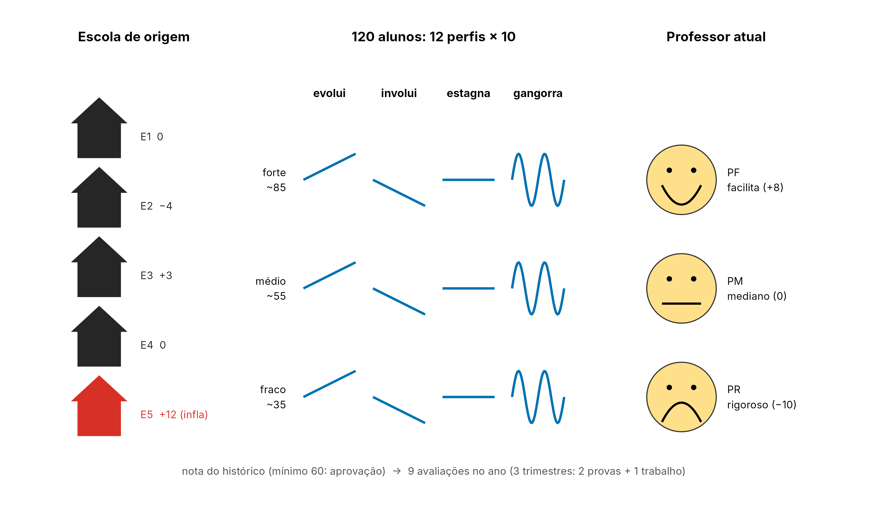
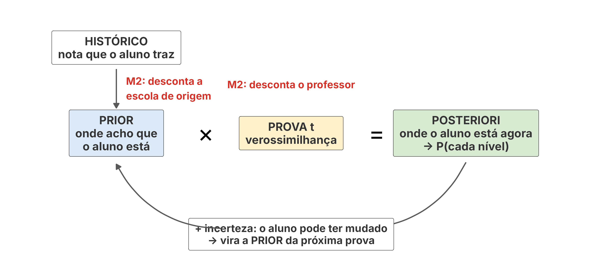
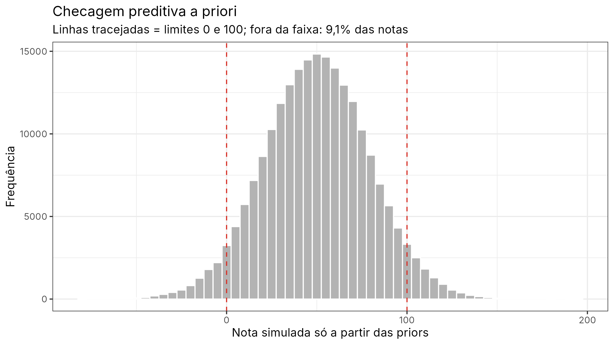
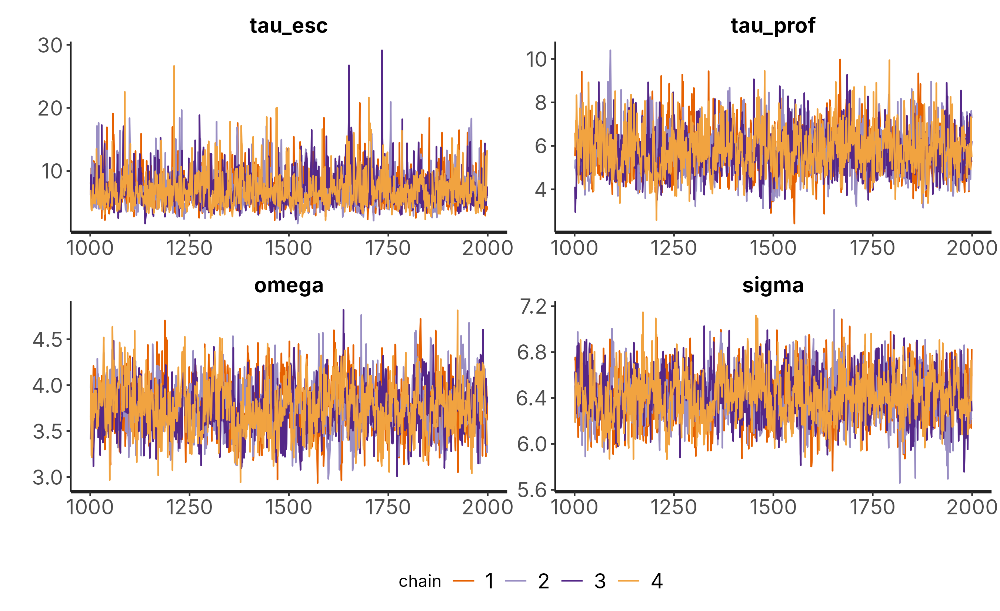
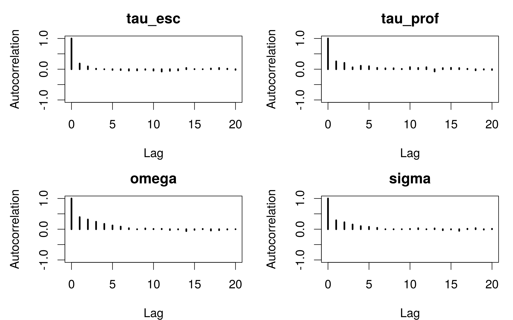
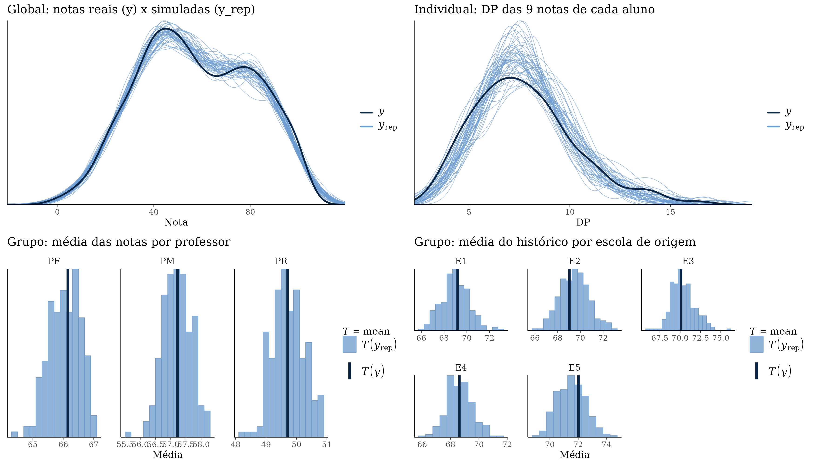
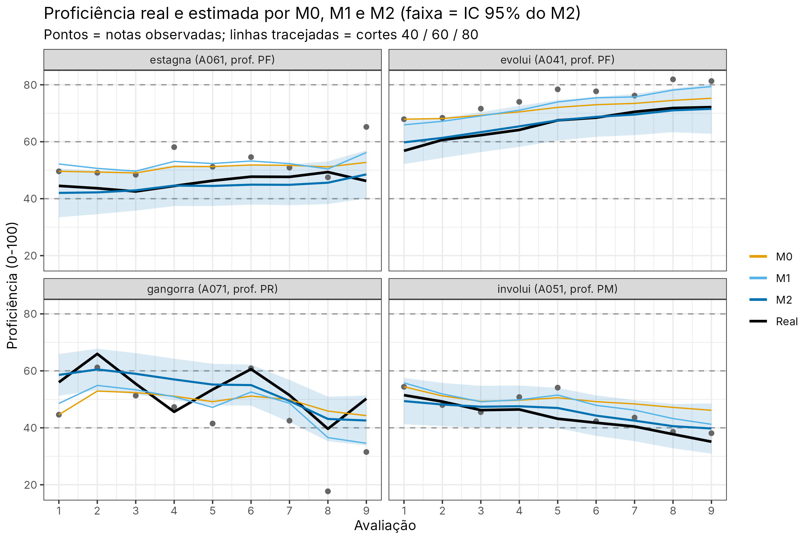
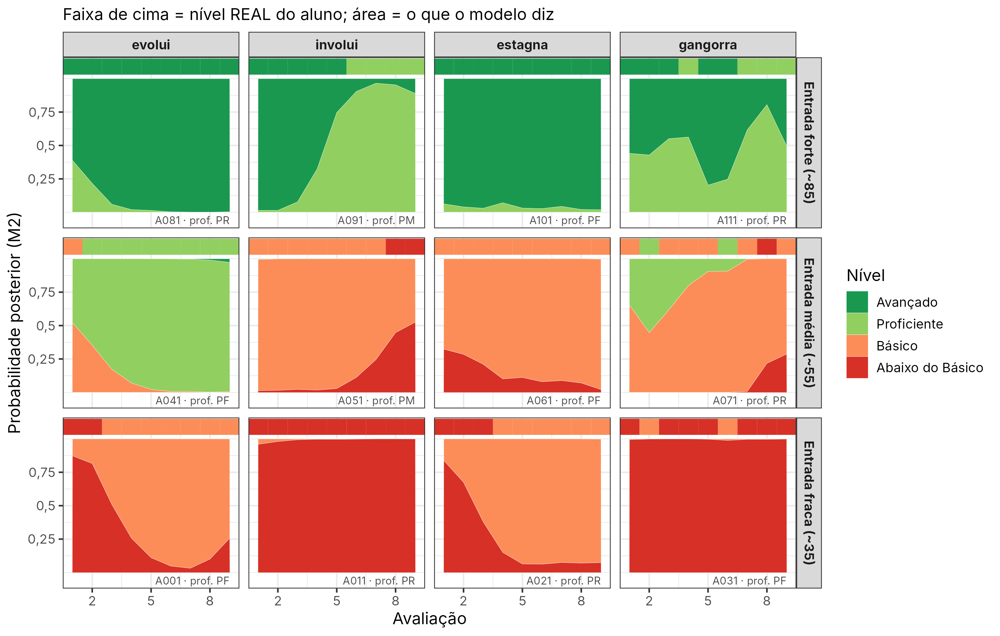
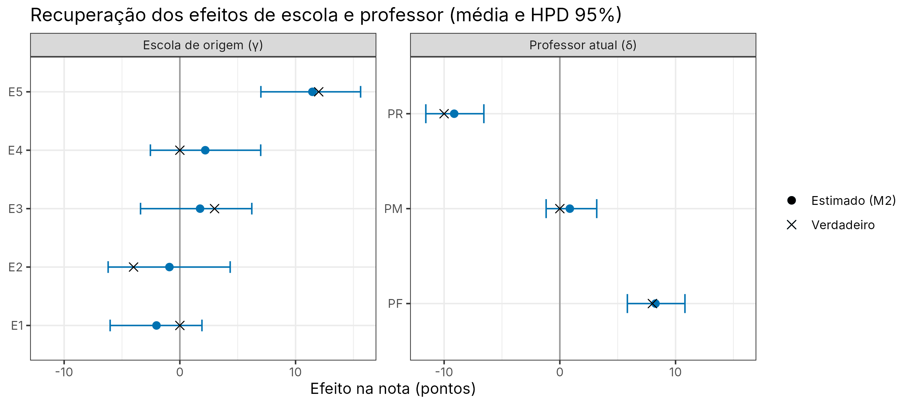
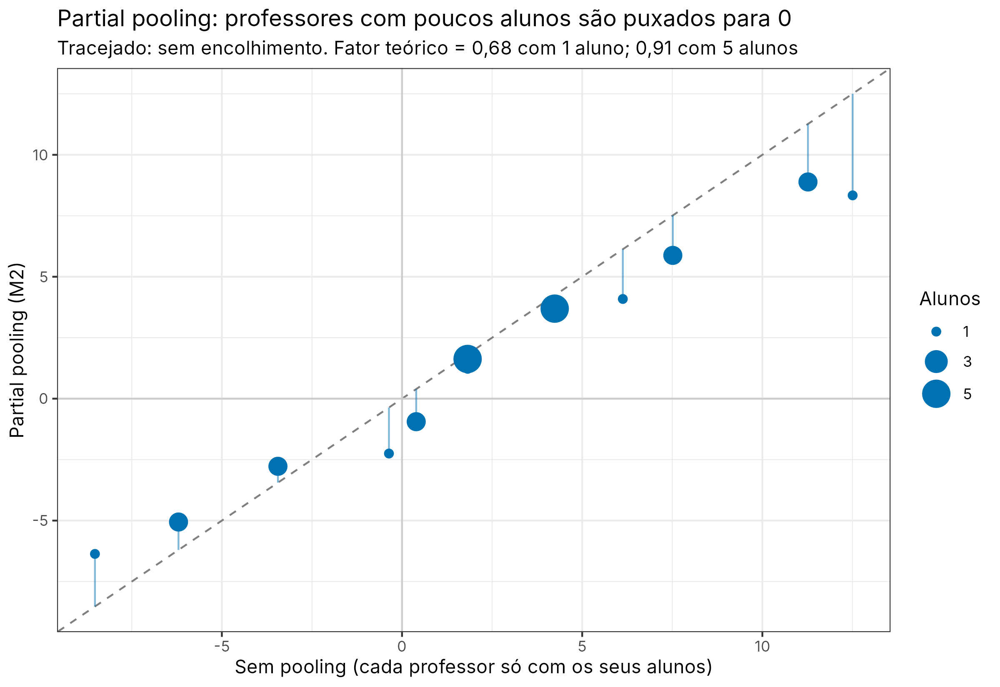

## Contexto

- O PAEBES classifica os alunos em **Abaixo do Básico**, **Básico**, **Proficiente** e **Avançado**, mas é aplicado poucas vezes
- No dia a dia, a escola só tem **notas de 0 a 100**, que dependem da **escola de origem** e do **rigor do professor** (Zitzmann et al., 2025)
- A média simples pesa igual provas antigas e recentes e não informa a incerteza

::: {.notes}
O PAEBES é a avaliação externa do Espírito Santo. Ele classifica os alunos em quatro padrões, mas acontece poucas vezes: não acompanha o aluno ao longo do ano.
O que a escola tem no dia a dia são as notas de 0 a 100 que os professores lançam. Só que essas notas carregam dois "ruídos": a escola de onde o aluno veio (umas inflam a nota) e o rigor do professor (um tira nota, outro dá).
A média simples tem dois problemas: dá o mesmo peso a uma prova de fevereiro e a uma de novembro, e não diz o quanto podemos confiar na classificação.
A ideia do trabalho é adaptar o modelo à rotina da escola, e não o contrário: usar só as notas que já existem.
Zitzmann et al. (2025): a crença prévia do avaliador (aqui, o histórico) só melhora a avaliação se for pouco viesada. Por isso é preciso descontar escola e professor.
:::

## Pergunta e objetivo

> Como acessar mais rápidamente o nível de proeficiência dos alunos?

**Objetivo:** propor e avaliar um modelo bayesiano que classifique o padrão de desempenho dos alunos em Biologia a partir do seu histórico escolar e das notas ao longo do ano letivo.

::: {.notes}
A pergunta tem duas partes: classificar melhor (acerto) e detectar mais cedo quando o aluno muda de nível (dinâmica).
Usamos dados simulados porque assim conhecemos a verdade e conseguimos medir o acerto. Com dados reais, a verdade não existe; por isso também avaliamos o modelo com critérios que não dependem dela (DIC, LOO, verificação preditiva).
:::

# Metodologia

## Dados simulados

{fig-align="center" width="100%"}

::: {.notes}
120 alunos: 3 níveis de entrada (fraco ~35, médio ~55, forte ~85) × 4 trajetórias ao longo do ano, 10 alunos em cada um dos 12 perfis.
Evolui: sobe ~20 pontos no ano. Involui: cai ~15. Estagna: fica estável. Gangorra: sobe e desce duas vezes. Todos com um pequeno ruído aleatório.
5 escolas de origem; a E5 (vermelha) infla as notas em 12 pontos. O professor de origem só é conhecido para ~40% dos alunos (em cidade grande, quase nunca se sabe).
Na escola atual há 3 professores: PF facilita (+8), PM é mediano (0) e PR é rigoroso (−10).
Cada aluno tem a nota do histórico (série anterior) e 9 avaliações no ano.
Regra de aprovação: só passa de série quem tem 60 ou mais. Um aluno com proficiência real 35 continua com 35, mas chega com histórico 60 ("aprovado no limite": recuperação, conselho de classe). Isso acontece com 60 dos 120 alunos. O 60, portanto, significa "60 ou menos".
Importante: o modelo NÃO conhece nada disso. É a verdade que ele precisa descobrir.
:::

## O modelo em 5 passos {.smaller}

::: {style="font-size: 0.88em"}
| Passo | M1: **fixos** $\sigma_0{=}10,\ \sigma{=}6,\ \omega{=}3$ | M2: **estimados** (Stan) |
|---|---|---|
| **1. Parâmetro** | $\theta_{it}$ = proficiência real do aluno $i$ na prova $t$ (traço latente, 0–100) | igual |
| **2. Prior** (chegada) | $\theta_{i0} \sim N(h_i,\ \sigma_0^2)$ | $h_i \sim N(\theta_{i1} + \gamma_{e} + \delta_{p},\ \sigma_h^2)$; o 60 vale "≤ 60" |
| **3. Verossimilhança** | $y_{it} \mid \theta_{it} \sim N(\theta_{it},\ \sigma^2)$ | $y_{it} \mid \theta_{it} \sim N(\theta_{it} + \delta_{a},\ \sigma^2)$ |
| **+ Dinâmica** | $\theta_{it} = \theta_{i,t-1} + \eta,\ \ \eta \sim N(0,\ \omega^2)$ | igual |
| **4. Posteriori** | Normal, fórmula fechada (filtro de Kalman) | amostras MCMC (NUTS) |
| **5. Classificação** | probabilidade de cada faixa (cortes 40 / 60 / 80) | igual |

**Kalman:** a cada prova, a nova estimativa é uma média ponderada entre o que se achava antes e a nota nova; pesa mais a que tem menos incerteza.  
M0 = média simples das notas: sem prior e sem probabilidade.
:::

::: {.notes}
Este é o roteiro clássico de uma análise bayesiana, em 5 passos, e é exatamente o que fazemos.
1. Parâmetro: θ é o traço latente, a proficiência real, que não se observa; só vemos as notas. Mesmo conceito da TRI.
2. Prior: o que sabemos do aluno ANTES das provas do ano = a nota do histórico. No M1 ela fica em θ_i0 (antes do ano); a dinâmica leva a θ_i1 somando ω², como em qualquer outra prova. No M1 ela entra crua como média da prior, com desvio 10 (um aluno de 35 que chegou com 60 começa o ano "em 60"). No M2 ela é corrigida pela escola de origem (γ) e pelo professor de origem (δ_p), e o 60 é tratado como "60 ou menos" (dado censurado).
3. Verossimilhança: cada nota do ano é a proficiência + erro de medida da prova (desvio 6 no M1). No M2, somamos o efeito do professor atual (δ_a).
Dinâmica: é o que difere da versão "de livro". No modelo Normal–Normal estático, todas as provas pesam igual e a posteriori é uma média ponderada entre o histórico e a média do ano; ele não percebe que o aluno mudou. Por isso, antes de cada prova, somamos uma pequena incerteza (η). Com η = 0 voltamos ao modelo estático.
4. Posteriori: FRASE RÁPIDA: "o Kalman é só a regra Normal–Normal aplicada prova a prova: a nova estimativa é uma média ponderada entre o que eu achava e a nota nova, e pesa mais quem tem menos incerteza". Ex.: prior com desvio 10 e prova com desvio 6 → a prova pesa ~74% (1/36 contra 1/100). Depois, alarga um pouco (ω) e repete. No M1, fórmula fechada (média ponderada pelas precisões, aplicada prova a prova = filtro de Kalman). No M2, não há fórmula fechada → MCMC.
5. Classificação: integra-se a posteriori em cada faixa. É a mesma ideia do PAEBES, mas na escala 0–100 com cortes 40/60/80 (a escala do PAEBES, 0–500, fica como trabalho futuro).
Se perguntarem sobre TRI: a TRI usaria os acertos item a item (modelo logístico de 2 ou 3 parâmetros) como verossimilhança. Aqui só temos a nota fechada de cada prova, então a verossimilhança é normal.

EXEMPLO PARA O QUADRO (KALMAN PASSO A PASSO, M1):
Ideia: quanto menor a incerteza de uma informação, mais ela pesa. Precisão = 1/variância.
Aluno chega com histórico 60 (desvio 10 → variância 100). Prova 1: nota 50 (desvio 6 → variância 36).
(No código, a prior fica no "momento zero" θ_i0, antes do ano, e antes da 1ª prova já se soma ω² = 9: a variância efetiva na prova 1 é 109, desvio ~10,4. Aqui uso 100 para simplificar a conta; o raciocínio é o mesmo.)
1) Precisões: prior 1/100 = 0,0100; prova 1/36 = 0,0278; soma = 0,0378.
2) Pesos: prova = 0,0278/0,0378 = 0,735 (74%); prior = 0,265 (26%). Atalho: 100/(100+36) = 0,735. A prova é ~3x mais precisa, leva ~3/4 do peso.
3) Média nova = 0,265 × 60 + 0,735 × 50 = 52,6. Forma do Kalman: 60 + 0,735 × (50 − 60) = 52,6 → a prova veio 10 abaixo do esperado e ando 74% do caminho até ela. Esse peso é o "ganho de Kalman".
4) Incerteza nova: precisões somam → 0,0378 → variância 1/0,0378 = 26,5 → desvio 5,1 (menor que 10 e que 6: juntar informação sempre aumenta a certeza).
Prever: o aluno pode ter mudado → variância 26,5 + ω² (9) = 35,5 → desvio 6,0. A média continua 52,6.
Prova 2 (nota 48): peso = 35,5/(35,5+36) = 0,50 (incertezas parecidas, meio a meio). Média = 52,6 + 0,50 × (48 − 52,6) = 50,3. Variância = 1/(1/35,5 + 1/36) = 17,9 → desvio 4,2.
E repete até a prova 9: atualiza, prevê, atualiza...
Papel do ω: sem ele a variância só cairia (26,5 → 15,3 → 10,8...), as provas novas pesariam cada vez menos e o modelo ficaria "teimoso". Com ω a variância não cai demais e cada prova nova sempre pesa: é isso que acompanha quem melhora ou piora.
Nome: Rudolf Kálmán (1960), usado na navegação da Apollo; o GPS faz o mesmo (prevê a posição, recebe o sinal, corrige ponderando pela confiança).
Frase: "cada nova estimativa anda na direção da nota nova uma fração do caminho; essa fração depende de quem é mais preciso: o que eu já sabia ou a prova."
:::

## M1: valores fixados e por quê {.smaller}

| Termo | O que é | Valor | Por quê |
|-----|------------|-----|------------------------------|
| $\sigma_0$ | incerteza da prior (histórico) | **10** | erro do histórico (5) + escola e professor de origem, que o M1 **não** desconta: $\sqrt{5^2+6^2+6^2}\approx 10$ |
| $\sigma$ | erro de medida de uma prova | **6** | é o erro usado na simulação |
| $\omega$ | quanto o aluno muda entre provas | **3** | tendências de ~2 a 2,5 pontos por avaliação + passeio aleatório (DP 2) |

Valores do **desenho da simulação**: favorece o M1, e mesmo assim o M2 classifica melhor.

::: {.notes}
No M1 as três variâncias são fixadas por nós; é o filtro de Kalman clássico, que precisa delas conhecidas.
σ0 = 10: o histórico tem erro 5, mas no M1 ele entra cru, sem descontar a escola de origem (a E5 infla 12) nem o professor de origem (de −10 a +8). Essa variação extra (~6 cada) se soma: raiz de 25 + 36 + 36 ≈ 10.
σ = 6: é exatamente o erro de medida usado para simular as provas.
ω = 3: nas trajetórias, o aluno muda em média 2 a 2,5 pontos por avaliação (ex.: involui −20 em 8 intervalos), mais um passeio aleatório de DP 2; juntando, ~3.
Ou seja, o M1 recebeu "cola" da simulação: os melhores valores possíveis. Isso deixa a comparação conservadora: se o M2 ganha mesmo assim, o ganho é real. Com dados reais esses valores não existiriam, e por isso o M2 os estima.
:::

## Como o modelo funciona

{fig-align="center" width="100%"}

::: {.legenda}
O histórico é a prior (Van Moere e Hanlon, 2020); cada prova atualiza; a posteriori vira a prior da próxima prova. O M2 corrige as notas pela escola e pelo professor.
:::

::: {.notes}
COMO EXPLICAR (o essencial):
1. A nota que o aluno traz (histórico) é a PRIOR: já dá uma primeira classificação (ex.: histórico 72 → provavelmente Proficiente).
2. Cada prova é a VEROSSIMILHANÇA. Prior × verossimilhança = POSTERIORI: onde o aluno está agora, com a probabilidade de cada nível.
3. Antes de virar a prior da próxima prova, a posteriori é alargada um pouco, porque o aluno pode ter mudado (o ruído ω). Sem isso, o modelo vira uma média.
4. O M1 faz exatamente esse ciclo com as notas como vêm. O M2 faz o mesmo ciclo, mas antes desconta a escola de origem (no histórico) e o professor (em cada prova). Quanto descontar, ele aprende olhando todos os alunos juntos: é isso que o torna hierárquico.

Van Moere e Hanlon (2020) fizeram o mesmo com testes de leitura: combinar as notas anteriores com a atual pelo teorema de Bayes dá estimativas mais precisas da habilidade (mais de 21 mil alunos, 3 a 5 testes cada).
Frase-resumo: "O modelo começa com o histórico como prior, atualiza a cada prova e, antes de cada passo, corrige a nota pela escola e pelo professor."

SE PERGUNTAREM OS DETALHES (o que é cada coisa no M2):
Nota do ano: y_it = θ_it + δ_a + erro (σ). Histórico: h_i = θ_i1 + γ_e + δ_p + erro (σ_h).
θ_it: proficiência real (o que queremos). Prior na chegada θ_i1 ~ N(50, 25²), vaga: pesa ~2% frente ao histórico. Depois θ_it = θ_i,t−1 + η, η ~ N(0, ω²), ω ~ half-N(0, 5).
γ_e: escola de origem ~ N(0, τ_esc²). δ_p e δ_a: professor de origem e atual ~ N(0, τ_prof²); os 3 atuais somam zero (identificabilidade).
σ ~ half-N(0, 10); σ_h ~ Gama(2; 0,2).
τ_esc e τ_prof: HIPERPARÂMETROS (o quanto escolas e professores variam), com HIPERPRIORI half-N(0, 10). Geram o partial pooling.
O histórico entra "como dado" (e não direto como média da prior) só porque a correção (γ e δ) também precisa ser estimada; na prática, ele faz o papel de prior.
Se perguntarem "a escola poderia ser hiperpriori do aluno?": aqui a escola mexe na NOTA (viés). Daria para pô-la também na prior do aluno (escolas que formam alunos melhores): θ ~ N(μ + u_escola, σ²). Na simulação isso não existe; com dados reais, seria a primeira extensão.
:::

## Distribuições e valores (M2) {.smaller}

::: {style="font-size: 0.85em"}
| Parâmetro | Prior (o que assumimos) | Posterior (média) |
|---|---|---|
| $\theta_{i1}$ proficiência na chegada | $N(50,\ 25^2)$ (vaga) | um valor por aluno |
| $\sigma$ erro das provas | half-Normal(0, 10) | **6,4** (real 6) |
| $\sigma_h$ erro do histórico | Gama(2; 0,2) | **4,0** (real 5) |
| $\omega$ mudança por prova | half-Normal(0, 5) | **3,8** (sem valor único: tendências + acaso) |
| $\gamma_e$ escola de origem | $N(0,\ \tau_{esc}^2)$ | E5: **+11,5** (real +12) |
| $\delta$ professor | $N(0,\ \tau_{prof}^2)$; atuais somam 0 | PR/PM/PF: **−9,1 / 0,9 / 8,3** (real −10 / 0 / 8)¹ |
| $\tau_{esc}$, $\tau_{prof}$ *(hiperparâmetros)* | half-Normal(0, 10) *(hiperpriori)* | **7,1** e **5,8** (real: ~6 entre escolas) |

¹ Efeito médio na nota: PR tira 10, PF dá 8. A estimativa é **relativa à média dos três** (soma zero): o real centrado seria −9,3 / 0,7 / 8,7.

**Total: 1.106 parâmetros** (1.080 $\theta_{it}$ + 26 globais e de grupo) para 1.200 observações · Sensibilidade: $\tau \sim$ half-Cauchy(0, 5) → mesmos resultados
:::

::: {.notes}
Cada linha: o que é, o que assumimos antes de ver os dados (prior) e o que o modelo estimou (média a posteriori). Como os dados são simulados, dá para comparar com o valor real.
θ_i1 ~ N(50, 25²) é vaga de propósito: quem informa o aluno é o histórico corrigido (pesa ~98%).
σ: o erro das provas sai 6,4, e o real é 6. ω: 3,8 pontos por prova, que é o quanto o aluno pode mudar entre provas.
σ_h ~ Gama(2; 0,2): escolhida para não deixar a variância ir a zero (com half-Normal a cadeia travava perto de 0). Estimou 4,0 (real 5): é o parâmetro mais difícil, porque há um só histórico por aluno, e metade deles está censurada em 60.
δ: na simulação, toda nota dada pelo PR é a proficiência − 10 + erro, e pelo PF, + 8 + erro. Em média, o PR tira 10 pontos e o PF dá 8 (um pouco menos para quem está perto de 100, por causa do teto). Como impomos soma zero, o M2 mede os professores em relação à média dos três: os reais −10/0/+8 somam −2, então, centrados, viram −9,3/+0,7/+8,7, bem perto do estimado.
τ_esc: o desvio-padrão dos 5 efeitos simulados (0, −4, +3, 0, +12) é ~6; o M2 estimou 7,1 (com só 5 escolas, é pouca informação).
ω: não há um valor verdadeiro único, porque as trajetórias são tendências programadas + acaso; 3,8 resume tudo isso (a gangorra muda mais rápido).
γ e δ: os efeitos de escola e professor vêm de uma normal comum, cuja largura (τ) também é estimada: isso é o hierárquico, e gera o partial pooling. Os 3 professores atuais somam zero para o modelo ser identificável (como y = μ + τ_i + e com Στ = 0).
τ_esc e τ_prof são hiperparâmetros; as priors deles são as hiperprioris.
CONTAGEM DE PARÂMETROS (1.106 livres):
- θ_it: 120 alunos × 9 avaliações = 1.080 (no Stan: 120 θ_i1 + 120 × 8 passos z da dinâmica, mesma coisa)
- γ_e: 5 escolas de origem
- δ_p: 14 professores de origem
- δ_a: 3 professores atuais, mas só 2 livres (o 3º é definido pela soma zero)
- 5 desvios-padrão: σ, σ_h, ω, τ_esc, τ_prof
Dados: 1.080 notas do ano + 120 históricos = 1.200 observações. São quase tantos parâmetros quanto observações; o modelo só funciona porque os θ estão ligados pela dinâmica e os efeitos pela estrutura hierárquica (partial pooling). É também por isso que o LOO por nota falhou: cada nota tem o seu próprio θ.
4 cadeias × 2.000 iterações (1.000 de aquecimento).
Sensibilidade: trocando a half-Normal por half-Cauchy(0, 5), nada muda. 2.000 iterações bastam com NUTS (critério = ESS e MCSE).
:::

## Verossimilhança {.smaller}

$$
L = \prod_{i=1}^{120}\Big[\prod_{t=1}^{9}\phi(y_{it};\,\theta_{it}+\delta_{a(i)},\,\sigma^2)\Big]\times L_{h,i}
$$

$$
L_{h,i} =
\begin{cases}
\phi(h_i;\ \mu_{h,i},\ s_i^2) & \text{se } h_i > 60 \ \text{(nota observada)}\\
\Phi\big((60-\mu_{h,i})/s_i\big) & \text{se } h_i = 60 \ \text{(só se sabe que era} \le 60)^{*}
\end{cases}
$$

$\mu_{h,i} = \theta_{i1}+\gamma_{e(i)}+\delta_{p(i)}$ · $s_i^2 = \sigma_h^2$ (prof. de origem conhecido) ou $\sigma_h^2+\tau_{\text{prof}}^2$ (desconhecido) · posterior $\propto L \times$ priors

::: {.notes}
A verossimilhança é o produto das contribuições de todas as observações: 1.080 notas do ano e 120 históricos.
(*) LEMBRETE: contar o percalço em tom leve: na primeira versão a simulação gerava históricos abaixo de 60, o que não existe (quem chega ao 9º ano foi aprovado). Percebi, corrigi a simulação (quem ficaria abaixo chega com 60) e passei a tratar o 60 como censurado.
Histórico: se a nota é maior que 60, entra a densidade normal, como antes. Se é 60, o aluno foi "aprovado no limite": só sabemos que a nota verdadeira era 60 ou menos. Então entra a PROBABILIDADE de ser ≤ 60 (a área da normal abaixo de 60, Φ), e não a densidade. Isso é um dado censurado. No Stan é uma linha: target += normal_lcdf(60 | mu, s).
Professor de origem desconhecido: o efeito dele é integrado e a variância do histórico vira σ_h² + τ_prof²: a informação do histórico fica mais fraca, sem precisar de imputação.
Posterior ∝ verossimilhança × priors. Como a posterior não tem forma fechada (são 1.106 parâmetros), usamos MCMC (NUTS, no Stan).
Esta mesma conta está no código (m2_loglik) e é usada no DIC.
:::

## O ruído da dinâmica (filtro de Kalman) {.smaller}

1. **Previsão:** antes da prova, a incerteza **aumenta** ($v + \omega^2$): o aluno pode ter mudado
2. **Atualização:** Normal–Normal, média ponderada pelas precisões

| | Peso da prova mais recente |
|---|---|
| Sem ruído ($\omega = 0$), 9ª avaliação | ~11% (≈ média simples) |
| Com ruído ($\omega = 3$) | **~39%** |

::: {.notes}
Sem ruído, o modelo assume que o aluno é o mesmo o ano todo e vira praticamente uma média: a 9ª prova pesa ~11%, como na média simples.
Com ruído, antes de cada prova a incerteza sobre o aluno aumenta, porque ele pode ter mudado. Aí a prova nova pesa ~39% e as antigas vão sendo esquecidas aos poucos (cada uma vale ~0,6 da seguinte).
Em palavras: o modelo "desconfia um pouco de si mesmo" a cada nova prova.
Ruído zero = média simples. Ruído grande demais = só olha a última prova e "pisca" entre níveis.
No M1 o ruído é fixo (3 pontos); no M2 é estimado (ω ≈ 3,9).
:::

## Checagem preditiva a priori

{fig-align="center" width="75%"}

::: {.legenda}
Escala certa, mas **9% das notas fora de 0–100**: as priors não conhecem o teto.
:::

::: {.notes}
Antes de olhar os dados, sorteamos parâmetros só das priors e simulamos notas.
A escala está certa (mediana 50), mas 9% das notas simuladas caem fora de 0–100.
A causa não é a prior de θ: é a verossimilhança. y ~ Normal permite notas acima de 100 mesmo com θ = 95 (basta o professor que facilita mais o erro).
Na realidade, as notas são CENSURADAS em 100: o aluno que "passaria" de 100 fica com 100. Nos dados, 28 das 1.080 notas estão em 100.
Decidimos manter o modelo normal e assumir isso como limitação; a correção (verossimilhança censurada) tiraria a fórmula fechada do LOO por aluno.
:::

## Classificação = teste de hipóteses

- Cada nível é uma **região** do parâmetro: $\text{Básico} = \{40 < \theta_{it} \le 60\}$
- $P(\text{Básico} \mid \text{dados})$ = proporção de amostras do MCMC na faixa (como as probabilidades de desempenho superior de Dias et al., 2022)
- Regras: nível mais provável × **troca só se $P > 0{,}7$**

::: {.notes}
No Tópico 8, um teste bayesiano é a probabilidade a posteriori de o parâmetro estar numa região.
Cada nível é uma região: Básico = θ entre 40 e 60. A probabilidade de o aluno ser Básico é a proporção de amostras do MCMC que caem nessa faixa (com θ truncado em 0–100).
É a mesma ideia de Dias et al. (2022), que usam a probabilidade a posteriori de desempenho superior para recomendar cultivares.
Duas regras: o nível mais provável, ou só trocar de nível quando P > 0,7. A segunda evita que o aluno "pisque" por causa de uma prova ruim.
:::

# Resultados

## M2: o caminho até o modelo final {.smaller}

| Tentativa | Div. | R-hat | δ PR / PM / PF |
|---|---|---|---|
| 1 · sem restrição | **9** | 1,02 | −5,5 / 4,3 / 12,0 |
| 2 · + soma zero | 0 | 1,01 | −9,1 / 0,9 / 8,2 |
| 3 · + Gama em $\sigma_h$ | 0 | 1,01 | −9,1 / 0,8 / 8,2 |
| 3 · com half-Cauchy | 0 | 1,02 | −9,1 / 1,0 / 8,1 |
| **4 · + δ não centrado** | **1** | **1,01** | **−9,1 / 0,9 / 8,3** |
| *verdadeiro* | | | *−10 / 0 / 8* |

**Tentativa 1 = modelo não identificável**, como $y = \mu + \tau_i + e$: somar 4 a $\theta$ e tirar 4 de $\delta$ dá o mesmo ajuste → restrição $\sum \delta = 0$.

::: {.notes}
COMO FALAR (o que cada coisa traz):
Ideia do slide: o M2 não saiu certo de primeira. Ajustamos 4 vezes, mudando UMA coisa por vez, e a tabela mostra o que cada mudança consertou. Mostra que checamos a convergência em vez de confiar no primeiro resultado.
Configuração: 4 cadeias independentes (cada uma começa de um ponto sorteado), 2.000 iterações cada, as 1.000 primeiras descartadas como aquecimento → 1.000 × 4 = 4.000 amostras da posteriori.
COLUNAS:
- Div. (divergências): avisos do Stan de que o amostrador "escorregou" numa região difícil da posteriori. Ideal = 0; muitas indicam amostras possivelmente erradas.
- R-hat (Gelman–Rubin): compara as 4 cadeias (variação entre elas × dentro de cada uma). ~1,00 = concordam; acima de ~1,01–1,05 = não concordam.
- δ PR / PM / PF: efeitos estimados dos professores atuais, para comparar com a linha "verdadeiro" (−10 / 0 / +8). Como os dados são simulados, sabemos a resposta certa.
TENTATIVAS:
1. Sem restrição: modelo NÃO identificável. A nota é θ + δ; somar 4 em todos os θ e tirar 4 de todos os δ dá as mesmas notas. Os dados não separam "aluno bom com professor rigoroso" de "aluno médio com professor neutro" (mesmo caso de y = μ + τ_i + e da aula). Resultado: 9 divergências e professores deslocados (−5,5 / 4,3 / 12,0, ~4 acima do real). O R-hat estava bom (1,02): as cadeias podem concordar entre si e mesmo assim dar a resposta errada.
2. + soma zero: o conserto principal. δ_PR + δ_PM + δ_PF = 0 → δ mede "quanto o professor difere da média dos professores"; a ambiguidade some. 0 divergências, efeitos −9,1 / 0,9 / 8,2 ≈ verdadeiros.
3. + Gama em σ_h: ajuste fino. σ_h (erro do histórico) com half-Normal podia encostar em zero ("histórico perfeito") e prender θ ao histórico; a cadeia andava devagar (ESS 307). A Gama(2; 0,2) tem densidade zero no zero ("o histórico sempre tem algum erro"): ESS sobe para 854. Os professores não mudam: melhora a qualidade da amostragem, não a resposta.
3 com half-Cauchy: teste de sensibilidade. Prior de τ com cauda mais pesada → mesmos resultados: a conclusão não depende dessa escolha de prior.
4. + δ não centrado: precaução técnica. Em vez de δ ~ N(0, τ²), sorteia-se z ~ N(0, 1) e δ = τ × z (mesma coisa matematicamente). Com poucos grupos (3 professores), quando τ fica pequeno os δ ficam espremidos perto de zero: o "funil", região estreita onde o amostrador escorrega. O z não é espremido. Resultado igual, 1 divergência em 4.000 (desprezível).
FRASE: "O primeiro ajuste convergiu, mas para a resposta errada: o modelo não era identificável. A soma zero resolveu. Depois só melhoramos a amostragem: a Gama impede o erro do histórico de ir a zero e a forma não centrada evita o funil. A troca de prior não mudou nada, então o resultado é robusto."

DETALHES (texto anterior):
Mudamos uma coisa por vez. Todas as tentativas já tratam o histórico 60 como censurado.
Tentativa 1: o modelo não é identificável. É o mesmo caso de y = μ + τ_i + e visto em aula: somar uma constante a todos os θ e tirar dos δ dá exatamente o mesmo ajuste. A prior segura os δ perto de zero, mas fraco: eles saíram ~3,5 pontos deslocados, e houve 9 divergências. Lição: cadeias "quase convergidas" ainda podem dar a resposta errada.
Tentativa 2: restrição de soma zero nos professores atuais. Os efeitos batem com a verdade e as divergências somem. Mas σ_h (erro do histórico) mistura mal: ESS 307, porque pode encostar no zero e "prender" θ ao histórico.
Tentativa 3: prior Gama(2; 0,2) para σ_h, que tem densidade zero no zero ("o histórico sempre tem algum erro"). O ESS de σ_h sobe para 854.
Tentativa 4: δ não centrado (δ = τ × z, com z ~ N(0, 1)). É a forma recomendada quando há poucos grupos: o amostrador anda em z, que não é espremido quando τ vai a zero (o "funil"). Numa versão anterior dos dados (sem a regra dos 60), foi o que destravou uma cadeia presa com a half-Cauchy (R-hat 5). Com os dados atuais, as duas formas convergem; mantivemos a não centrada por segurança. Ela teve 1 divergência em 4.000 iterações, o que é desprezível (os diagnósticos estão todos ok).
:::

## Convergência do modelo final {.smaller}

:::: {.columns}
::: {.column width="50%"}
{height="285px" fig-align="center"}
:::
::: {.column width="50%"}
{height="285px" fig-align="center"}
:::
::::

:::: {.columns style="font-size: 0.8em"}
::: {.column width="50%"}
| Diagnóstico | Resultado |
|---|---|
| Traço (4 cadeias) | misturadas, sem tendência |
| Gelman–Rubin | ≤ 1,01 |
| Autocorrelação | ~0 antes do lag 10 → sem thin |
| ESS · MCSE | > 540 · ≤ 0,07 ponto |
:::
::: {.column width="50%"}
| Diagnóstico | Resultado |
|---|---|
| Geweke (\|z\| > 1,96) | 5 de 52 (acaso ≈ 2,6) |
| Heidelb.–Welch | aprovado |
| Raftery–Lewis | não se aplica |
| half-Cauchy | o mesmo (Geweke 10 de 52) |
:::
::::

::: {.notes}
COMO LER CADA DIAGNÓSTICO (gráficos à esquerda):
- Traço (gráfico de cima): o valor sorteado em cada iteração (eixo x = iteração 1.000 a 2.000, depois do aquecimento), uma cor por cadeia. Bom = "lagarta peluda": as 4 cores misturadas, oscilando em torno do mesmo nível, sem tendência de subir/descer e sem uma cadeia isolada. É o que se vê.
- Gelman–Rubin (R-hat): a versão numérica do traço. Compara a variação ENTRE as cadeias com a variação DENTRO de cada uma. Se as 4 exploram a mesma região, dá ~1,00. Regra: < 1,01 (ou < 1,05, mais tolerante). Aqui ≤ 1,01.
- Autocorrelação (gráfico de baixo, os "tracinhos"): correlação entre um sorteio e o sorteio k passos depois (k = defasagem/lag). Lag 0 é sempre 1. Bom = os tracinhos caem rápido para perto de zero. Aqui caem antes do lag 5–10. Por isso NÃO precisamos de thin (guardar 1 a cada k): o thin serve para quando a autocorrelação demora a cair (típico do Gibbs/Metropolis); com o NUTS ela já cai rápido, e jogar amostras fora só perderia informação.
- ESS (tamanho efetivo da amostra): quantas amostras INDEPENDENTES as 4.000 correlacionadas valem. Quanto mais autocorrelação, menor o ESS. Referência: > 400. Aqui o mínimo é 545.
- MCSE (erro de Monte Carlo): o quanto a média posterior mudaria se rodássemos o MCMC de novo; ≈ DP posterior / √ESS. Aqui ≤ 0,07 ponto numa escala 0–100: desprezível.
- Geweke: compara a média do começo da cadeia (10%) com a do fim (50%) por um teste z. Se a cadeia estabilizou, as duas são iguais e |z| < 1,96. Com 52 testes, ~5% (≈ 2,6) dão |z| > 1,96 só por acaso. Half-Normal: 5 de 52, perto disso. Half-Cauchy: 10, um pouco acima, mas R-hat e ESS estão bons.
- Heidelberger–Welch: testa se a cadeia é estacionária (não está mais "andando") e se a média está estimada com precisão. Aprovado em todos, exceto γ_E2 em 1 das 4 cadeias, sem importância com R-hat ≤ 1,01.
- Raftery–Lewis: calcula quantas iterações seriam necessárias para estimar um quantil (ex.: 2,5%) com certa precisão. Exige ≥ 3.746 amostras por cadeia para rodar; temos 1.000, então não se aplica. Foi pensado para Gibbs, com muita autocorrelação.
Frase: "As 4 cadeias se misturam, a autocorrelação cai rápido (por isso não fiz thin), e todos os diagnósticos do coda passam."

DETALHES (texto anterior):
Os mesmos diagnósticos do pacote coda usados na disciplina.
Gelman–Rubin ≤ 1,01: as 4 cadeias concordam.
ESS > 540 e MCSE ≤ 0,07 ponto: há amostras efetivas suficientes, e o erro do próprio MCMC é desprezível frente à incerteza dos parâmetros.
Heidelberger–Welch aprovado em todos os parâmetros, exceto o efeito da escola E2 em 1 das 4 cadeias (half-Normal), o que não preocupa com Gelman–Rubin ≤ 1,01 e ESS alto. Geweke: 5 de 52 testes com |z| > 1,96 na half-Normal (≈ o esperado por acaso, 2,6) e 10 na half-Cauchy, um pouco acima; mas o Gelman–Rubin e o ESS, que comparam as 4 cadeias, estão bons.
Raftery–Lewis não se aplica: exige pelo menos 3.746 amostras por cadeia; foi pensado para amostradores com muita autocorrelação, como o Gibbs.
SE PERGUNTAREM POR QUE NUTS E NÃO GIBBS/METROPOLIS: o NUTS é um Metropolis–Hastings em que as propostas são guiadas pelo gradiente da posteriori. Com mais de 1.000 parâmetros correlacionados (θ, γ e δ disputam a mesma informação) e priors não conjugadas (half-Normal, Gama), o Gibbs andaria em "escadinha" e o Metropolis de passeio aleatório daria passos minúsculos; os dois precisariam de dezenas de milhares de iterações. O NUTS converge com 2.000 e ainda dá o diagnóstico de divergências, que guiou as tentativas 1 a 4.
:::

## O modelo reproduz os dados?

{fig-align="center" width="82%"}

::: {.legenda}
p bayesiano entre 0,17 e 0,66 nos três níveis · exceção: **máximo (p = 1,00)**, notas acima de 100
:::

::: {.notes}
Verificação preditiva a posteriori: simulamos dados novos a partir da posterior e comparamos com os reais, em três níveis (Tópico 9).
Global: a distribuição das notas simuladas cobre a real.
Individual: a variação das 9 notas de cada aluno é reproduzida (p = 0,60).
Grupo: a diferença entre professores (p = 0,45) e entre escolas no histórico (p = 0,66) também. No histórico, as réplicas também passam pela regra dos 60.
O mínimo tem p = 0,17: aceitável, mas o modelo tende a gerar notas mínimas um pouco menores que as reais.
p perto de 0,5 = o dado real parece típico entre os simulados. A exceção é o máximo (p = 1,00): o modelo gera notas acima de 100 porque não sabe da censura em 100.
COMO EXPLICAR O p BAYESIANO: p = proporção das réplicas em que a estatística simulada é MAIOR ou igual à real: p = P(T(y_rep) ≥ T(y) | y). Não é um p-valor de teste (não há hipótese nula a rejeitar); é "onde o dado real cai dentro do que o modelo gera".
p ≈ 0,5: o valor real fica no meio dos simulados → o modelo reproduz bem aquela característica.
p perto de 0 ou de 1: o valor real fica na ponta → o modelo gera sistematicamente valores maiores (p ≈ 1) ou menores (p ≈ 0) que o real → falha naquela característica. Por isso o bom é perto de 0,5, e não "acima de 0,05".
Máximo, p = 1,00: em TODAS as réplicas o maior valor simulado passou do maior valor real. O real não passa de 100 (a nota é limitada a 0–100), mas o modelo normal não conhece esse teto e gera notas como 105 ou 110. É a limitação da censura em 100 (28 das 1.080 notas). Não afeta a classificação, mas mostra onde melhorar.
Mínimo, p = 0,17: um pouco para a ponta (o modelo gera mínimos algo menores que o real), mas aceitável.
Mensagem: convergência e "ser o melhor modelo" não garantem adequação; a checagem mostra onde ainda falha.
:::

## Comparação de modelos (sem usar a verdade) {.smaller}

**Chegou um aluno novo: o modelo prevê bem as notas dele?**

| Modelo | DIC | LOOIC por aluno |
|---|---|---|
| **M2 completo** | **7.835** | **8.426** |
| M2 sem escola e professor | 7.939 | 8.508 |

Diferença de ELPD = 41,1 (EP 7,6) · o completo prevê melhor **93 de 120** alunos

::: {.notes}
Comparamos o M2 com o mesmo modelo sem escola e professor. Nenhum critério aqui usa a verdade da simulação, então vale para dados reais.
DIC: o critério da disciplina; menor é melhor.
LOO por aluno: esconde um aluno inteiro e vê se o modelo prevê as notas dele. Para isso, os θ do aluno são integrados, e a integral sai pelo mesmo filtro de Kalman do M1 (conferido contra a normal multivariada).
Com o histórico censurado (60), o Kalman sozinho não basta, porque o 60 não é uma normal. A conta vira p(notas do ano) × P(histórico ≤ 60 | notas do ano): o primeiro fator sai do Kalman e o segundo do suavizador de Kalman (que volta da avaliação 9 até a 1). Conferido contra integração numérica.
Primeira tentativa, LOO por nota: descartada, porque cada nota tem seu próprio θ e a aproximação falha (59 de 1.200 com Pareto-k > 0,7).
Por aluno, 4 ficaram com k > 0,7: alunos em que o histórico pesa muito. Sem eles, a diferença fica em 45,3. O completo prevê melhor 93 dos 120 alunos.
:::

## Trajetórias estimadas

{fig-align="center" width="88%"}

::: {.notes}
Um aluno de cada trajetória, todos de entrada média.
Preto: proficiência real. Laranja: média simples (M0). Azul-claro: M1. Azul-escuro: M2, com faixa de 95%.
Painéis de cima (professor PF, que facilita): M0 e M1 seguem as notas infladas e superestimam o aluno; o M2 desconta o efeito do professor e cola na linha preta.
Involui: a média simples fica para trás; o M2 acompanha a queda.
Gangorra: nenhum modelo acompanha cada oscilação, e isso é desejável: não se quer trocar o aluno de nível a cada prova.
:::

## Um aluno de cada perfil

{fig-align="center" width="95%"}

::: {.notes}
Cada painel é UM aluno (um de cada perfil: linha = entrada, coluna = trajetória). Embaixo, o código do aluno e o professor atual dele.
Faixa de cima: o nível REAL do aluno em cada avaliação (da simulação). Área colorida: a probabilidade de cada nível segundo o M2.
O que mostrar: quando o nível real muda, a cor dominante do modelo muda junto, com um pequeno atraso. Ex.: A051 (médio, involui) cai para Abaixo do Básico na avaliação 8, e o vermelho cresce ali. A001 e A021 (fracos) passam a Básico, e o modelo acompanha.
Gangorra (A071, A111): o real oscila; o modelo oscila menos, de propósito, para não "piscar" a cada prova.
É a mesma leitura de um gráfico do STRUCTURE: a cor dominante é o nível mais provável.
:::

## Desempenho da classificação {.smaller}

| Modelo | Acerto | Trocas/aluno | Mudanças não detectadas |
|---|---|---|---|
| M0 · média simples | 66,4% | 0,58 | 48,1% |
| M1 · limiar 0,7 | 67,9% | 0,62 | 38,3% |
| **M2 · limiar 0,7** | **82,8%** | 0,36 | 39,5% |
| M2 · maior probabilidade | 84,7% | 0,60 | 30,9% |

Trocas reais: 1,55 por aluno · 81 de 120 alunos mudam de nível

::: {.notes}
Aqui usamos a verdade da simulação.
Acerto: o M2 classifica certo ~83% das vezes, contra 66% da média simples e 68% do M1.
O M1 sofre com a regra dos 60: um aluno de 35 que chegou com 60 começa o ano "em 60" e só é corrigido depois de algumas provas. Nas avaliações iniciais, o M1 chega a ficar abaixo da média simples.
Trocas por aluno: na realidade são 1,55. O nível mais provável troca mais (0,60); o limiar 0,7 troca menos (0,36), ao custo de detectar mais tarde.
Mudanças não detectadas: quantas mudanças reais de nível o modelo nunca percebeu. O M2 com maior probabilidade perde menos (31%).
Equilíbrio: o limiar evita "piscar", o nível mais provável reage mais rápido.
:::

## O rigor do professor importa {.smaller}

| Professor atual | M0 | M1 | **M2** |
|---|---|---|---|
| PR · rigoroso (−10) | 55,3% | 59,1% | **79,2%** |
| PM · mediano (0) | 79,2% | 79,0% | **85,3%** |
| PF · flexível (+8) | 61,7% | 63,0% | **83,3%** |

Acerto da classificação (regra do limiar 0,7)

Prior viesada não ajuda (Zitzmann et al., 2025): o M1 usa o histórico **sem ajuste** e fica perto da média simples

::: {.notes}
Com o professor mediano, todos os modelos vão razoavelmente bem.
A diferença aparece com os professores que distorcem a nota: com o rigoroso, a média simples acerta só 55% e o M2 acerta 79%.
O M1 já tem a dinâmica, mas não tem o professor: melhora pouco. O ganho grande vem de estimar o efeito do professor (e da escola).
Isso corrobora Zitzmann et al. (2025): incorporar informação prévia melhora a avaliação do aluno apenas quando ela é pouco viesada (avaliador levemente viesado, confiança moderada). O M1 usa o histórico cru, viesado pela escola e pelo professor de origem, e fica perto da média simples; o M2 desconta esses vieses e dá o salto.
Kaplan et al. (2023), em avaliações de larga escala (PISA): dados históricos heterogêneos são mais bem aproveitados quando o quanto se "empresta" deles é estimado, e não fixado. É o que o M2 faz com σ_h e τ.
:::

## Efeitos e teste de hipóteses

{fig-align="center" width="85%"}

::: {.legenda}
$P(\delta_{\text{PR}} < 0 \mid y) = 1{,}00$ · $P(\delta_{\text{PF}} > 0 \mid y) = 1{,}00$ · PM: $P(|\delta| < 2 \mid y) = 0{,}84$ (ROPE)
:::

::: {.notes}
O M2 recuperou os efeitos simulados: X = verdadeiro, ponto = estimado, barra = HPD 95%.
A E5 foi estimada em +11,5 (HPD 7,0 a 15,6; verdadeiro +12). Professores: −9,1 / +0,9 / +8,3 (verdadeiros −10 / 0 / +8; centrados, −9,3 / +0,7 / +8,7).
Teste de hipóteses (Tópico 8): a probabilidade a posteriori de o PR tirar nota é 1,00, e a de o PF dar nota também.
ROPE: considerando ±2 pontos uma diferença desprezível na prática, o PM tem probabilidade 0,84 de estar nessa região, ou seja, de não distorcer a nota.
:::

## Partial pooling

{fig-align="center" width="62%"}

::: {.legenda}
Fator de encolhimento $= \tau^2 / (\tau^2 + \sigma_h^2/n)$: **0,68** com 1 aluno → **0,91** com 5
:::

::: {.notes}
Professores de origem: no eixo x, a estimativa de cada professor feita só com os alunos dele (sem pooling); no y, a do M2 (partial pooling). O tamanho do ponto é o número de alunos.
A estimativa do M2 é encolhida em direção a zero (a média do grupo) por um fator τ²/(τ² + σ_h²/n): 0,68 para quem tem 1 aluno e 0,91 para quem tem 5. Os valores observados batem com essa fórmula (0,67 a 0,75 com 1 aluno; 0,87 a 0,89 com 5). Só entram os alunos com histórico observado (> 60); os censurados não dão a nota exata.
Interpretação: professor com pouca informação própria "empresta força" do grupo, e a estimativa fica mais estável. O encolhimento não é erro; é o efeito da hiperpriori (τ estimado).
Para professores cuja estimativa "sem pooling" fica perto de zero, a razão fica instável e não deve ser lida.
:::

# Conclusão

## Conclusão {.smaller}

- O modelo bayesiano dinâmico **classifica melhor** que a média simples (83% × 66%)
- O ganho vem de **estimar o rigor do professor e a escola de origem**, confirmado pelo DIC e pelo LOO
- A dinâmica **acompanha quem melhora ou piora**
- **Limitação:** notas **censuradas em 100**, tratadas como normais (convergiu e é o melhor, mas ainda não é perfeito)
- **Perspectiva:** dados reais da Sedu
  - histórico do 6º ao 9º ano → prior do 1º ano = posteriori do fim do EF
  - PAEBES como régua externa → **prever o nível do aluno no PAEBES**

::: {.notes}
Respondendo à pergunta: sim, o modelo bayesiano dinâmico classifica melhor que a média simples, e o ganho principal vem de estimar o professor e a escola, o que se confirma também sem usar a verdade (DIC e LOO).
A dinâmica faz o modelo acompanhar quem melhora ou piora.
Limitação: as notas são censuradas em 100 e o modelo as trata como normais; isso aparece na verificação preditiva do máximo.
Próximos passos: dados reais da Sedu (com anuência e comitê de ética), tratar também a censura em 100 (a mesma ideia do 60) e possivelmente a escola também na prior do aluno.
Duas extensões que não mudam a lógica do modelo:
(1) Histórico completo do 6º ao 9º ano: em vez de uma nota só, roda-se o mesmo ciclo desde o 6º ano; a posteriori no fim do 9º vira a prior do 1º ano. As notas recentes pesam mais automaticamente, e a largura da prior sai da conta (não do desvio padrão de 4 notas, que seria instável). A passagem Ciências → Biologia pode ter um ω maior.
(2) PAEBES: com alunos que tenham notas da escola e PAEBES, acrescenta-se PAEBES_i ~ N(a + b·θ_i, σ_P²). Isso dá a régua comum (efeitos de escola e professor em termos absolutos, não só relativos) e permite prever, pela preditiva a posteriori, a probabilidade de cada aluno ficar em cada padrão do PAEBES, como alerta precoce. Cuidados: nota escolar e PAEBES não medem exatamente a mesma coisa; checar a calibração das probabilidades; usar como apoio, não como rótulo.
:::

## Referências {.smaller}

- Carpenter, B. et al. (2017). Stan: a probabilistic programming language. *Journal of Statistical Software*, 76(1).
- Dias, K. O. G. et al. (2022). Leveraging probability concepts for cultivar recommendation in multi-environment trials. *Theoretical and Applied Genetics*, 135, 1385–1399.
- Gelman, A. (2006). Prior distributions for variance parameters in hierarchical models. *Bayesian Analysis*, 1(3), 515–534.
- Kalman, R. E. (1960). A new approach to linear filtering and prediction problems. *Journal of Basic Engineering*, 82(1), 35–45.
- Kaplan, D. et al. (2023). Bayesian dynamic borrowing of historical information with applications to the analysis of large-scale assessments. *Psychometrika*, 88(1), 1–30.
- Spiegelhalter, D. J. et al. (2002). Bayesian measures of model complexity and fit. *JRSS B*, 64(4), 583–639.
- Van Moere, A.; Hanlon, S. (2020). A Bayesian approach to improving measurement precision over multiple test occasions. *Language Testing*, 37(4), 482–502.
- Vehtari, A.; Gelman, A.; Gabry, J. (2017). Practical Bayesian model evaluation using LOO-CV and WAIC. *Statistics and Computing*, 27, 1413–1432.
- Zitzmann, S. et al. (2025). Novick meets Bayes: improving the assessment of individual students in educational practice and research by capitalizing on assessors' prior beliefs. *Educational and Psychological Measurement*, 85(3), 483–506.

::: {.notes}
Stan: software de MCMC usado (NUTS). Gelman 2006: priors para variâncias em modelos hierárquicos (half-Cauchy). Kalman 1960: o filtro. Spiegelhalter 2002: DIC. Vehtari 2017: LOO e WAIC. Dias et al. 2022: probabilidades a posteriori (desempenho superior) para recomendar cultivares, a mesma ideia da probabilidade de cada nível. Van Moere e Hanlon 2020: histórico como prior, atualizado a cada teste. Zitzmann et al. 2025: a prior só ajuda se for pouco viesada (explica M1 ≈ M0). Kaplan et al. 2023: empréstimo de informação histórica estimado, não fixado.
:::
